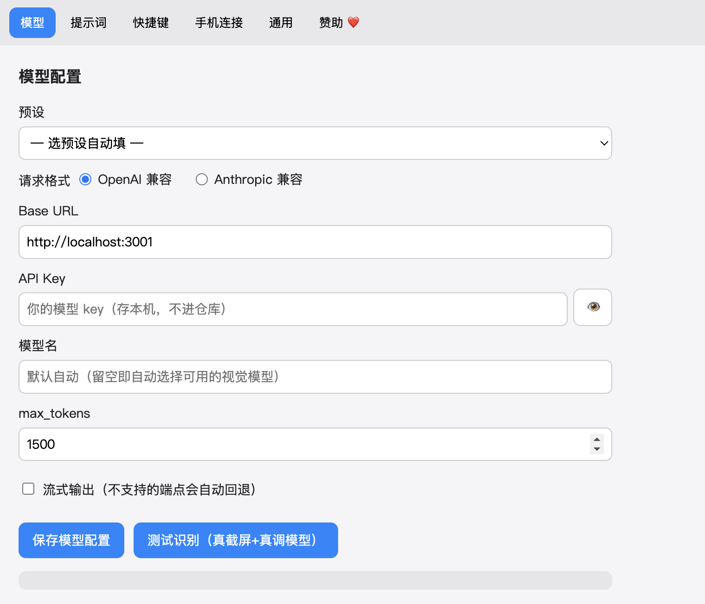
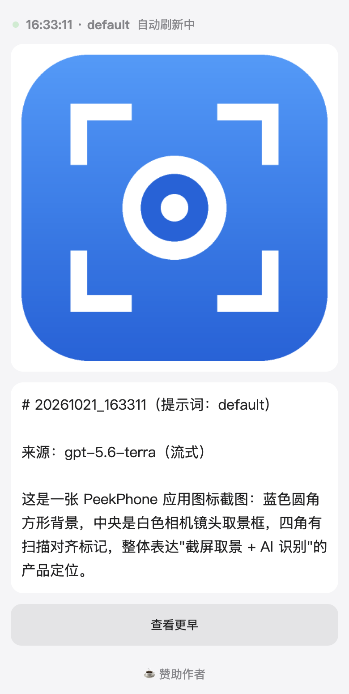

# PeekPhone

按快捷键全屏截图 → 用你自己的多模态大模型分析 → 手机扫码在浏览器看结果。跨平台（macOS / Windows）Electron 托盘 App。

*Hit a hotkey to screenshot your screen, have your own multimodal LLM analyze it, then read the result on your phone over your LAN. Cross-platform (macOS / Windows) Electron tray app.*

---

## 这是什么

常驻菜单栏/托盘的小工具：

1. 按全局快捷键（默认 **⌘⌥P** / Windows `Ctrl+Alt+P`）静默截取主屏。
2. 压成长边 1200 的 JPEG，发给**你在设置里填的**大模型，按选定提示词分析。
3. 结果推到本机局域网 HTTP 服务，**手机扫码**或输本地 URL，在浏览器里看「最新一条」，页面每 2 秒自动刷新。

手机只看结果，不装任何 App。

## 演示 / Screenshots

| 设置（模型页）| 手机页·最新一条 |
|---|---|
|  |  |

> 均为本机真实运行截图（Electron `capturePage`）。本机无 `ffmpeg`/`gifski` 工具链，未伪造动图，用静态截图序列代替演示。
> *Real screenshots captured on-device; no gif toolchain available locally, so static shots are used instead of a faked animation.*

## v0.2 新增 / What's new in v0.2

- **修 OpenAI 路径 `/v1` bug**：base 不含版本段（如 `http://localhost:3001`）时自动补 `/v1`，不再 404；自带版本段（智谱 `/v4`、百炼 `/compatible-mode/v1`）不重复拼接。
- **模型自动识别 + 优先级回退**：模型名**留空即「自动」**，对多模型网关（返回 `supported_models` 的反代）自动挑一个支持视觉的模型；手填的模型若被上游下线/不支持，自动回退到可用视觉模型，不用你手动改。
- **错误归类成人话**：连不上 / 超时 / Key 无效 / 地址不对 / 模型不可用 / 不支持图片 / 太大 / 限流，都翻译成「原因 + 怎么办」一句话，原始报文折叠在「点开看详情」里。
- **手机历史可翻页**：默认仍只看最新一条，底部「查看更早」一条条往前翻，翻页时暂停自动刷新，「回到最新」恢复。
- **流式输出**：支持流的端点边收边显示（手机页文本逐步变长）；不支持流的端点（如本机反代）自动回退非流式，不会弄挂。per-provider 开关，默认关。
- **应用 / 托盘图标**：蓝色取景框 + 镜头的品牌图标（`assets/icon-src/` 下矢量源 + 零依赖生成脚本）。
- **赞助页**：托盘「赞助作者 ❤️」入口 + 手机页首次分析成功后低调提一次（可关闭、只提一次）。
- **测试即保存**：设置页「测试识别」通过后自动落盘，不再出现「测了没保存、手机还用旧配置」的脱节；改了没保存关窗口会提示。
- **失败不打扰**：截图/分析失败不弹任何桌面通知，原因写进手机页 error 态 + `userData/logs/peek.log` 滚动日志。
- **包体积**：mac x64 dmg 从 ~103MB 降到 ~89.5MB（maximum 压缩 + 语言包裁剪 + files 收窄）。

## 与同类项目的差异

GitHub 上「截图问 AI」的工具不少，PeekPhone 故意收敛成这三点，和它们划清界线：

- **本地局域网，不走云**：结果经本机 HTTP + token 推到手机浏览器，没有云中转、没有账号体系、没有服务器留你的截图。
- **自带 key**：不内置任何模型 key，你填自己的多模态模型（智谱 / 百炼 / 任意 OpenAI 或 Anthropic 兼容端点）。
- **明确不做隐身 / 反检测**：市面上有些「截图问 AI」主打活动监视器不可见、录屏不可见、点击穿透、无痕运行（如面试作弊类工具）。**PeekPhone 坚决不做这类特性** —— 既是安全合规考量，也是和那类工具的本质区分。它是一个老实的桌面小工具，纯托盘不进 Dock 只是常规行为，不隐藏进程、不躲避录屏。

## 安装

mac 包做了本地 **ad-hoc 签名**（让屏幕录制权限能真正生效），但**未公证**（因为没有 Apple 开发者账号，属正常）；Windows 包未签名。首次打开仍会被系统拦：

- **macOS**：右键 App →「打开」→ 再点「打开」绕过 Gatekeeper；或 系统设置 → 隐私与安全性 → 「仍要打开」。然后到 系统设置 → 隐私与安全性 → **屏幕录制**，把 PeekPhone 的开关打开。
- **Windows**：SmartScreen 拦截时点「更多信息」→「仍要运行」。

*The mac build is **ad-hoc signed** locally (so Screen Recording permission actually takes effect) but **not notarized** (no Apple Developer account — this is expected). On first launch: right-click the app → Open → Open again to bypass Gatekeeper, then enable PeekPhone under System Settings → Privacy & Security → Screen Recording. On Windows, click "More info" → "Run anyway" when SmartScreen blocks it.*

从 [Releases](../../releases) 下载对应平台安装包（由 GitHub Actions 构建），或本地构建：

```bash
npm install
npm start          # 开发运行
npm run dist:mac   # 打 mac dmg
npm run dist:win   # 打 win nsis
```

## 配置与使用

1. 启动后点托盘图标 →「打开设置」。
2. **模型**：选预设（智谱 / 百炼）或自定义，填 Base URL / API Key / 模型名（**留空即自动选可用视觉模型**），可勾「流式输出」。点「测试识别」真截一张验证——**测通即自动保存**。
3. **手机连接**：手机连同一 WiFi，扫二维码或打开显示的 `http://<局域网IP>:<端口>/?t=<token>`。
4. 按快捷键截图，手机页面几秒后自动刷出截图 + 分析。
5. **提示词**：内置 `default`（通用屏幕解读）/ `code`（代码报错排查）/ `data`（图表数据解读）三套，可编辑、可新增、可删。想要「答题器」之类专用场景，自己新增一套即可。

### macOS 屏幕录制权限

截图依赖「屏幕录制」权限。首次截图时系统会请求授权，在 **系统设置 → 隐私与安全性 → 屏幕录制** 中放行 PeekPhone 后**重开 App**。开发期（`npm start`，由终端拉起）授权对象可能是终端/Electron，打包成 PeekPhone.app 后需**重新授权一次**。若 `screencapture` 子进程在你的 macOS 版本上截到黑帧，App 会自动降级到进程内的 `desktopCapturer`。

#### 故障排查：授了权仍截不了图 / Troubleshooting

屏幕录制权限绑定在**代码签名身份**上。如果你曾装过更早的**未签名**版本并授过权，升级到本版后系统可能把两者当成不同身份，导致列表里打了勾却仍截不到图（报 `Failed to get sources`）。此时在终端跑一次下面的命令清掉旧授权记录，再重开 App 重新授权即可：

```bash
tccutil reset ScreenCapture com.peekphone.app
```

*Screen Recording permission is tied to the app's code-signing identity. If you previously granted permission to an older **unsigned** build, after upgrading macOS may treat it as a different identity — the checkbox stays on but capture still fails (`Failed to get sources`). Run the command above once to clear the stale grant, then reopen the app and re-authorize.*

## 安全说明

- 本地服务监听 `0.0.0.0`：**同子网主机都能连到这个端口，token 是唯一防线**，别把带 `?t=<token>` 的链接转发出去。
- 服务是**明文 HTTP**（非 HTTPS），同网段抓包可见图片和 token，**只在可信网络用**。
- 设置里有「重置 token」，点一下旧链接立即失效。
- 你的模型 key 只存在本机 `app.getPath('userData')/config.json`（mac `~/Library/Application Support/PeekPhone/`，win `%APPDATA%/PeekPhone/`），**不进代码、不进仓库、不进日志**。
- 截图会发送给你配置的第三方 AI 服务，**请勿截取敏感或公司内部内容**。

## 已知限制

- **不做隐身 / 反检测**：无活动监视器隐藏、无录屏不可见、无点击穿透、无无痕运行。
- **不支持纯修饰键双击快捷键**（如 ⌘⌘）：Electron `globalShortcut` 不支持单纯/双击修饰键，请用带字母的组合键。
- **只截主屏**：多屏时请把内容拖到主屏。
- **Windows 包 / Apple Silicon 包未在本机实测**：本机是 Intel Mac，只验证了 x64 dmg 能装能跑；Windows（`desktopCapturer` 截图路径、清晰度）和 arm64 包由 CI 构建保证能编译，运行正确性需对应平台用户反馈。
- 手机只读看结果，不能对着截图继续追问；要换角度就在电脑换提示词重截。
- 局域网 IP 随 DHCP / 换网络变化，换网后在设置里重新看二维码。
- mac 开机自启在部分系统可能需手动到系统设置里添加（ad-hoc 签名、未公证）。

## 架构

- `src/main/` 主进程：`capture`（截图）/ `llm`（多 provider 调用 + 重试 + 双格式）/ `server`+`page`+`store`（手机服务）/ `pipeline`（编排）/ `tray`/`shortcut`/`config`/`prompts`/`net`/`ipc`/`windows`。
- `src/renderer/` 设置 UI（纯 HTML/CSS/JS，无框架）。
- `src/preload/` contextBridge 白名单。
- 运行时第三方依赖只有 `qrcode`；HTTP 服务、HTTP 客户端、图片压缩全用系统/内置能力。

从 Python 原型（`screencapture`+`sips` 截图、多 provider LLM、局域网页面）移植而来，业务逻辑逐函数照搬，承载方式换成常驻 Electron App。

v0.2 的模型调用层（`llm.js`）新增：URL 版本段判定、SSE 流式解析（Node 内置，无库）、模型自动识别 + 优先级回退、错误归类层；失败滚动日志落 `userData/logs/peek.log`。

## 赞助 / Sponsor

如果 PeekPhone 帮到了你，欢迎支持一下 ☕。开源免费，赞助全凭自愿。
收款码在应用内：托盘菜单「赞助作者 ❤️」或设置页「赞助」标签页可以看到（官方发布版内置，自行构建的 fork 不含）。

*If PeekPhone helps you, feel free to support it ☕. It's free and open-source; sponsoring is entirely optional. The QR code lives inside the app (tray menu or Settings → Sponsor) in official release builds.*

## License

MIT，见 [LICENSE](./LICENSE)。
